# 🛡️ DataFix – Autonomous Data Quality & Repair Engine

> **"Build for Trust: A successful DataFix solution should not simply clean data — it should prove what it changed, why it changed it, and how the repaired dataset was validated."**

---

## 📌 Executive Summary

**DataFix** is an autonomous, explainable data quality detection, root-cause diagnosis, and safe repair platform. Built for mission-critical enterprise data engineering, analytics, and machine learning pipelines, DataFix accepts real-world dirty datasets, identifies latent defects across 10 distinct failure vectors, diagnoses systemic upstream root causes, applies conservative reversible repairs, cryptographically validates the results, and produces a complete audit ledger.

---

## 🔄 The DataFix 10-Stage Lifecycle

```mermaid
flowchart LR
    A["1. INGESTION<br/>(CSV/XLSX/JSON)"] --> B["2. PROFILING<br/>(Stats & Types)"]
    B --> C["3. DETECTION<br/>(10 Failure Vectors)"]
    C --> D["4. DIAGNOSIS<br/>(Heuristic & Stats)"]
    D --> E["5. REPAIR<br/>(Autonomous / Safe)"]
    E --> F["6. VALIDATION<br/>(Re-scan & Diff)"]
    F --> G["7. INVARIANCE<br/>(Zero Unlogged)"]
    G --> H["8. EXPLANATION<br/>(Narratives)"]
    H --> I["9. AUDIT<br/>(Provenance Log)"]
    I --> J["10. EXPORT<br/>(Data & HTML)"]
```



---

## 🚀 Key Features

### 1. Multi-Vector Automated Defect Detection
- **Missing & Blank Cells:** Detects null, NaN, None, and whitespace-only empty strings.
- **Exact & Fuzzy Duplicates:** Locates duplicate rows and identifies fuzzy person/entity duplicates using token similarity (RapidFuzz / SequenceMatcher).
- **Format Syntax Invalidation:** Validates RFC-5322 emails, detects common keyboarding domain typos (`@gmaill.com`), and validates phone numbers.
- **Date & Numeric Errors:** Flags mixed date formats (`MM/DD/YYYY` vs `YYYY-MM-DD`), unparseable dates, and impossible negative numbers in positive fields (e.g. negative age, price, or quantity).
- **Inconsistent Categoricals:** Identifies aliases and abbreviations (e.g., `CA` vs `California`, `HR` vs `Human Resources`, `electrnx` vs `Electronics`).
- **Whitespace & Casing Glitches:** Locates leading/trailing copy-paste whitespace padding and inverted caps-lock casing (`bOB SMITH`).
- **Unexpected Data Types:** Flags numeric columns polluted with currency symbols (`$`), commas (`,`), or percent signs (`%`).
- **Statistical Anomalies & Outliers:** Computes Interquartile Range (IQR) fences ($Q_1 - 1.5 \times IQR$ to $Q_3 + 1.5 \times IQR$) and Z-score deviations.
- **Cross-Column Business Logic:** Identifies ledger calculation mismatches ($\text{Total} \neq \text{Qty} \times \text{Price}$) and temporal impossibilities ($\text{Hire Date} < \text{Birth Date}$).

### 2. Intelligent Root Cause Diagnosis
- Analyzes defect distribution patterns to identify systemic origins.
- Differentiates **Human Keyboarding Typos**, **Multi-Source ETL Ingestion Drift**, **Calculation Ledger Drift**, and **Upstream Null Dropouts**.
- Clearly labels inferred causes versus ground-truth facts with confidence metrics.

### 3. Autonomous & Conservative Repair Center
- High-confidence ($\ge 85\%$) safe repairs can be executed autonomously with one click.
- Supports median imputation for numeric fields, mode imputation for categorical fields, date ISO-8601 normalization, email typo correction, and arithmetic resynchronization.
- **Zero Silent Overwrites:** Destructive operations and outlier capping are strictly opt-in.
- **Full Undo Manager:** Step-by-step state rollback and one-click revert to the immutable original.

### 4. Mathematical Quality Scoring (0–100)
Transparently evaluated across 5 core dimensions:
$$\text{Quality Score} = 0.25 S_{\text{comp}} + 0.25 S_{\text{valid}} + 0.20 S_{\text{cons}} + 0.15 S_{\text{uniq}} + 0.15 S_{\text{integ}}$$

### 5. Verification & Audit Provenance
- **Dataset Immutability:** SHA-256 fingerprint computed on initial upload to guarantee baseline immutability.
- **Cell Invariance Guarantee:** Validates that every modified cell corresponds to an authorized, logged audit entry.
- **Downloadable Artifacts:** Cleaned CSV, Excel (`.xlsx`), JSON, audit ledger (CSV/JSON), and standalone executive HTML certificates.

---

## 📂 Project Architecture

```
DataFix/
│
├── app.py                     # Main Streamlit operations dashboard
├── config.py                  # Global configurations, severity thresholds, weights
├── requirements.txt           # Python dependencies
├── README.md                  # Documentation and user manual
├── run.bat                    # Windows one-click launcher
├── run.sh                     # Linux / macOS one-click launcher
│
├── modules/                   # Core business logic modules
│   ├── upload.py              # Ingestion, sample selection, and session init
│   ├── profiling.py           # Statistical profiling and cardinality analysis
│   ├── detection.py           # 10-vector automated defect detection engine
│   ├── diagnosis.py           # Intelligent root cause diagnostic engine
│   ├── repair.py              # Autonomous and safe repair engine
│   ├── validation.py          # Post-repair validation and invariance verifier
│   ├── explainability.py      # Plain-English decision narrative generator
│   ├── audit.py               # Audit ledger and state rollback manager
│   ├── quality_score.py       # Multi-dimensional 0-100 scoring engine
│   └── export.py              # Serialization and executive HTML certificate generator
│
├── utils/                     # Utility and security helpers
│   ├── data_integrity.py      # SHA-256 immutability & cell invariance verification
│   ├── file_handler.py        # Safe ingestion, encoding fallback, and export
│   └── helpers.py             # Fuzzy string similarity, regex patterns, and UI formatters
│
├── sample_data/               # Pre-configured demonstration datasets
│   ├── sample_customers.csv   # Customer contacts, casing, typos, and outliers
│   ├── sample_sales.csv       # E-commerce orders, math mismatches, negative quantities
│   └── sample_employees.csv   # HR records, temporal inversions, salary formatting
│
├── tests/                     # Real automated unit and integration tests
│   ├── test_detection.py      # Detection suite across all 10 defect vectors
│   ├── test_repair.py         # Repair candidate, execution, and imputation tests
│   ├── test_validation.py     # Post-repair validation and score delta tests
│   └── test_integrity.py      # SHA-256 hash and invariance verification tests
│
├── reports/                   # Output directory for exported reports
│   └── .gitkeep
│
└── assets/                    # Styling and presentation
    └── styles.css             # Modern Navy, Cyan & White UI theme
```

---

## 🛠️ Installation & Quickstart

### Prerequisites
- Python 3.10, 3.11, 3.12, 3.13, or 3.14
- Standard pip package manager

### Option A: One-Click Launchers

#### On Windows:
Double-click `run.bat` or run in terminal:
```cmd
run.bat
```

#### On Linux / macOS:
```bash
chmod +x run.sh
./run.sh
```

---

### Option B: Manual Setup

1. **Clone or Navigate to the Workspace:**
   ```bash
   cd sapthahack
   ```

2. **Create and Activate a Virtual Environment:**
   - **Windows:**
     ```cmd
     python -m venv venv
     venv\Scripts\activate
     ```
   - **Linux / macOS:**
     ```bash
     python3 -m venv venv
     source venv/bin/activate
     ```

3. **Install Dependencies:**
   ```bash
   pip install -r requirements.txt
   ```

4. **Launch Application:**
   ```bash
   streamlit run app.py
   ```
   Open your browser to `http://localhost:8501`.

---

## 🧪 Running Automated Tests

DataFix includes comprehensive unit tests verifying detection, repair, invariance, and immutability:

```bash
# Run all tests using unittest discovery
python -m unittest discover -s tests -p "test_*.py"
```

Or run individual test suites:
```bash
python -m unittest tests/test_detection.py
python -m unittest tests/test_repair.py
python -m unittest tests/test_validation.py
python -m unittest tests/test_integrity.py
```

---
